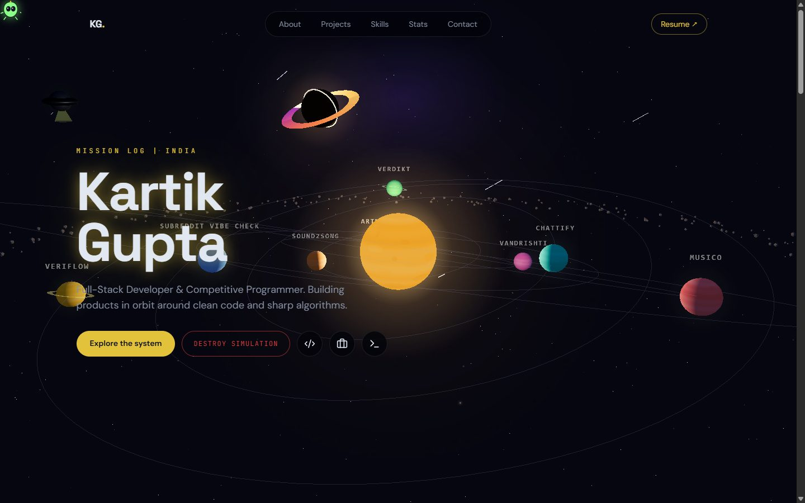

# Kartik Gupta — Space Portfolio

**A 3D solar system where every project is a planet.**

Click a planet to fly to it, scroll to sweep the camera across the system, and
press Ctrl+P to print my résumé.

**[Live site → kartik-gupta-ten.vercel.app](https://kartik-gupta-ten.vercel.app/)**



---

## About me

I'm a B.Tech Computer Science student at Bharati Vidyapeeth College of
Engineering (GGSIPU), class of 2028, with a 9.13 CGPA. I build full-stack
products on the MERN stack and practise data structures and algorithms in C++
every day — 800+ problems solved and counting.

[GitHub](https://github.com/Kartik5463) ·
[LinkedIn](https://www.linkedin.com/in/kartik-gupta-395727327) ·
[LeetCode](https://leetcode.com/u/Kartik5647) ·
[Codolio](https://codolio.com/profile/Kartik9696) ·
[kg9818630@gmail.com](mailto:kg9818630@gmail.com)

## Featured projects

Each one is a planet in the scene. Click it on the site for the full write-up,
code and live demo.

| Project                  | What it is                                                                   | Links                                                                                                              |
| ------------------------ | ---------------------------------------------------------------------------- | ------------------------------------------------------------------------------------------------------------------ |
| **Sound2Song**           | Identifies the songs in any YouTube video, with title, artist and timestamps | [Code](https://github.com/Kartik5463/Sound2Song)                                                                   |
| **ArtMart**              | Full-stack photography marketplace with JWT auth and AI-assisted listings    | [Code](https://github.com/Kartik5463/ArtMart)                                                                      |
| **Chattify**             | Real-time chat with group rooms, typing indicators and read receipts         | [Code](https://github.com/Kartik5463/Chattify) · [Demo](https://chattify-navy.vercel.app)                          |
| **Subreddit Vibe Check** | Scores the sentiment of a subreddit's posts to read the community's mood     | [Code](https://github.com/Kartik5463/Subreddit-vibe-check) · [Demo](https://subreddit-vibe-check-indol.vercel.app) |
| **Verdikt**              | Hackathon hosting platform — team project, Dogfood hackathon                 | [Code](https://github.com/Dogfood-Hackathon-Team-ByteMe/Verdikt)                                                   |
| **Musico**               | Music streaming interface with playlists and player controls                 | [Code](https://github.com/Kartik5463/Musico)                                                                       |
| **Veriflow**             | AI-verified escrow on PayPal — team project, PayPal AI Hackathon             | [Code](https://github.com/3Bit-Crew/Veriflow) · [Demo](https://veriflow-web-f4u1.onrender.com)                     |
| **VanDrishti**           | Behaviour-aware AI for wildlife monitoring — team project, Hack@BVP 8.0      | [Code](https://github.com/TeamVanRakshak/VanDrishti)                                                               |

## What's in it

- **A real-time 3D scene.** Eight planets on non-colliding orbits around the
  sun, plus an asteroid belt, black hole, wormhole, meteors and passing UFOs.
- **Live data.** Project details (descriptions, stars, last push, demo links)
  come from the GitHub API. Problem-solving stats — questions solved, rating,
  streak, active days — come from the Codolio API.
- **"Destroy simulation".** An asteroid hits the sun, a shockwave knocks each
  planet out of orbit in turn, and the system rebuilds itself.
- **Printable résumé.** Ctrl+P swaps the whole page for a one-page A4 résumé.
- **Fast on modest hardware.** The scene loads after the page is usable. It
  compiles its shaders without freezing the page and builds itself in small
  steps, and its quality and frame rate adapt to the device — including
  devices with no GPU.

## Tech stack

|           |                                                                                                  |
| --------- | ------------------------------------------------------------------------------------------------ |
| Framework | [TanStack Start](https://tanstack.com/start) (React 19, server-side rendering, server functions) |
| 3D        | [three.js](https://threejs.org) via [React Three Fiber](https://r3f.docs.pmnd.rs) and drei       |
| Styling   | Tailwind CSS v4                                                                                  |
| Language  | TypeScript                                                                                       |
| Testing   | Vitest and Testing Library                                                                       |
| Hosting   | Vercel (Cloudflare by default, through Lovable)                                                  |

## Running locally

You need Node.js — version 24 is what the site is deployed on.

```sh
git clone https://github.com/Kartik5463/Kartik-Gupta.git
cd Kartik-Gupta
npm install
npm run dev
```

| Command         | What it does                    |
| --------------- | ------------------------------- |
| `npm run dev`   | Starts the dev server           |
| `npm run build` | Builds for production           |
| `npm run test`  | Runs the test suite             |
| `npm run lint`  | Runs ESLint and Prettier checks |

## Making changes

| To change…                                     | Edit                                                                               |
| ---------------------------------------------- | ---------------------------------------------------------------------------------- |
| The projects shown, their order and their text | `FEATURED` in [`src/components/space/planets.ts`](src/components/space/planets.ts) |
| The printed résumé                             | [`src/components/resume/resume.ts`](src/components/resume/resume.ts)               |
| Name, title and profile links                  | `PROFILE` in [`src/components/space/planets.ts`](src/components/space/planets.ts)  |
| Page sections and copy                         | [`src/routes/index.tsx`](src/routes/index.tsx)                                     |

`FEATURED` is a hand-picked list — nothing ranks or reorders it automatically.
Each entry names a GitHub repository; add `owner` when the repo belongs to an
organisation rather than to `Kartik5463`. The "View code" link is built from
that, and everything else (stars, last update, demo link) is fetched live. The
demo link comes from the **Website** field in the repo's About section on
GitHub.

## Deploying

`vercel.json` already holds everything Vercel needs, so importing the
repository is enough. It builds with `NITRO_PRESET=vercel`, which produces
`.vercel/output` in Vercel's Build Output format.

Without that variable the build targets Cloudflare, which is what the
[Lovable](https://lovable.dev) integration deploys. Set `NITRO_PRESET` to any
[Nitro preset](https://nitro.build/deploy) to target another host — for
example `node-server` for a plain Node server.

## License

[MIT](LICENSE)
